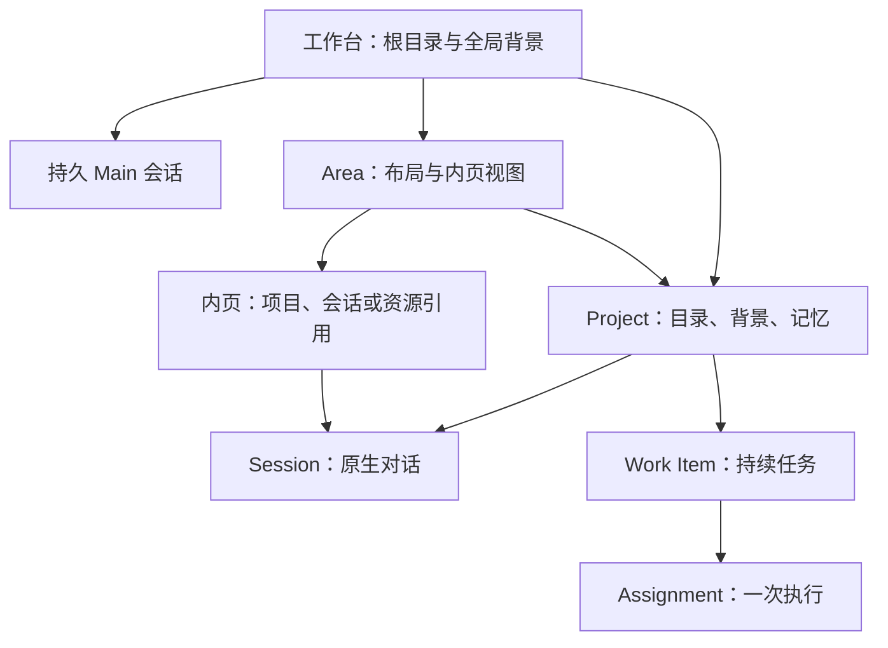

# DSH Bay 18.0 当前架构

更新日期：2026-11-11。依据功能提交 `ab2a7d8` 和当前公共契约核对。本文描述已有实现；原始计划和阶段审计见[归档](archive/README.md)，验收范围见[验证记录](VALIDATION.md)。

## 领域关系



工作台登记项目，区域展示项目。项目由稳定 `projectId` 标识，路径独立于显示名；`areaId` 表示当前展示位置或历史来源。一个区域可以展示多个 Session；关闭区域不删除 Project、原生对话或任务。

同一真实目录在工作台中对应一个 Project，多个区域共享背景与记忆。重新打开项目创建新区域并显示概览，历史会话和内页由用户主动打开。普通会话与 Worker 读取自身项目背景；Main 使用工作台根目录及全局概览。

## 持久化与唯一数据来源

```text
工作台根目录/
├─ .bay/
│  ├─ workbench.json         工作台定义、项目引用、布局、逻辑会话目录
│  ├─ context/               工作台背景 Markdown 投影
│  └─ memory/                工作台级记忆
└─ <用户选择的项目目录>/
   ├─ .bay/
   │  ├─ project.json        项目身份、名称、结构化背景及冲突候选
   │  ├─ context.md          项目背景 Markdown 投影
   │  └─ memory/             项目记忆索引、正文、来源与修订
   └─ 项目工作文件
```

| 数据 | 权威来源 |
| --- | --- |
| 工作台定义与布局 | 根目录 `.bay/workbench.json`；当前文件 envelope 为 schema 2 |
| 项目背景 | 项目 `.bay/project.json`，schema 1；Markdown 是可读投影 |
| 背景和记忆的客户端数据 | Host 合成快照；Settings 适配层不另存可独立修改的业务主副本 |
| 根目录位置与原生身份映射 | 本机 Profile 的工作台登记 |
| 活动会话、工具历史与附件 | DSH 原生 Session Persistence 和资源接口 |
| Work Item、Assignment、Attention | Host 编排状态、NDJSON 事件与 checkpoint |
| 浏览器租约、访客许可与运行实例 | Host 本机运行态；不写入完整包 |

主写入入口是 Host。目录服务使用版本检查、串行提交、文件锁、原子文件替换及恢复记录；客户端不能绕过该边界直接写项目管理文件。编排存储的状态、事件、checkpoint 当前仍分别写文件，并非整体原子事务，也不是无界追加日志。详见 [Bay Agent 存储说明](BAY-AGENT-ORCHESTRATION-CONTEXT-ENGINE.zh-CN.md)。

## 服务与视图

| 层 | 入口与职责 |
| --- | --- |
| Host 初始化 | `src/index.ts` 与 `host-*.ts` 安装目录、访问、会话、编排、分享和完整包服务 |
| 目录与项目 | `host-workbench-directory-service.ts` 独立初始化；`host-workbench-directory.ts` 统一登记和定义写入；`host-workbench-projects.ts` 处理项目元数据与 18.0 归属升级 |
| 客户端接缝 | `src/client/` 连接原生 Slot、文件型 Settings、浏览器控制和扩展注册 |
| 工作台界面与模型 | `src/foundation/` 同时包含 UI、布局模型、持久化投影、控制器及受控上游适配，并非单纯的基础工具目录 |
| Bay Agent | `host-bay-agent.ts` 注册 Main preset 和工具；Worker 适配原生会话；Controller 管理任务与执行身份 |
| 访问与窗口 | `host-workbench-access.ts`、原生访问适配及浏览器/分享网关限定目标与主控代次 |
| 完整包 | `host-workbench-complete.ts` 管理后台作业；文件、原生会话和任务快照由各自适配器处理 |

目录与记忆服务不以 Bay Agent 是否可启动为前提。创建会话仍需要原生会话服务就绪；失败时保留已创建目录和重试身份。

视图、原生会话和 Agent 执行有不同生命周期。区域、浮动页、原版对话与浏览器释放各自的界面引用，不把离开视图当作删除会话。输入组件恢复需重新取得有效上下文；真实发送是否成功仍需安装验收。

## 背景、记忆与 Agent Loop

背景是明确目标和约束，默认空；记忆保存带来源的知识与修订；原始对话保留在 DSH，任务事实保留在编排账本。它们不互相替代。

Bay Main 与 Worker 都由 DSH 原生 Agent Loop 执行。Bay Main 自有 preset 已接入原生自动压缩、`/compact` 和工具结果裁剪。Bay 另有编排 checkpoint 和有界上下文投影。Worker 模式从当前注册表发现，排除 Bay 自身和失效模式；不硬编码任务与模式的对应关系，也不在缺省时静默使用标准模式。

背景辅助填写是独立单轮草稿服务，用户保存前不会覆盖正式背景，也不进入 Main 对话。项目上下文按 projectId 获取，区域切换不会改变历史会话的所属项目。

## 在线访问与离线迁移

浏览器接管访问主机上的同一个工作台，不复制根目录。桌面、浏览器主控与访客经过 Host 访问服务；浏览器交还不停止已有后台任务或局域网分享。恢复细节见[浏览器说明](BROWSER-WORKBENCH.zh-CN.md)。

完整工作台包 V5（`workbench-complete`）包含工作文件、项目 `.bay` 数据、会话目录及原生历史/附件、任务快照和可迁移插件制品。导出默认包含根内文件，明确报告排除项或外部依赖。导入预检后重建本机映射，数据、环境和任务状态分别报告，任务等待用户继续。

历史布局与扩展分发格式仍有独立代码和审计投影，不能视作完整会话迁移。目录型工作台的导入 UI 只提供 V5 完整包。扩展运行文件遵循自己的白名单，不能把工作台全部文件塞进扩展制品。

17.x Settings 工作台和旧完整包不进入 18.0 迁移路径。早期 18.0 文件型定义可由 Host 整理到项目模型；无法唯一归属的背景、记忆或任务须保留候选/待处理信息，不能猜测归属。

## 当前边界与下一步

完整自动化和封包记录已建立，真实模型连续运行、跨平台迁移矩阵及跨设备协作仍需专项验收。当前 CI 只在 Ubuntu 上运行 `pnpm verify`，并非三平台矩阵。

后续源码目录优化应从 `foundation` 混合职责、Host 服务边界和持久化依赖入手，先明确模块契约，再以测量结果决定性能工作。该重构尚未实施。
