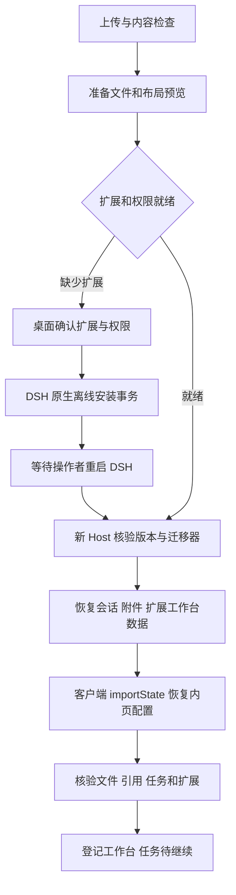

# 完整工作台 V6：导出、两阶段导入与验证边界

实施日期：2026-11-11，随 `0.2.2-alpha.18.1` 实现；当前候选为 `0.2.2-alpha.18.6`，目标宿主 DSH `0.2.2-rc.2`。本文说明数据与功能合同；当前候选自动化和人工验收状态以[验证记录](VALIDATION.md)为准。

## 包与边界

新导出使用 `type: workbench-complete, version: 6`。读取器支持 18.0 V5 与当前 V6，不支持 17.x 工作台或旧布局包。传输 URL 和作业存储目录仍保留 `complete/v5`、`.dsh-workbench/complete-v5`，这是旧上传与作业续跑的稳定地址，不表示新包仍为 V5。

包内包含：

```text
manifest.json                 来源/目标系统、扩展锁、摘要、任务与会话引用
files.ndjson                  工作文件逐项清单
workbench/                    工作台根目录（含隐藏文件、空目录、.git、项目资料）
native/native-sessions.json   原生会话与附件目录
native/sessions/              完整逻辑会话事件
native/attachments/           附件实际内容
orchestration.json            可选任务快照
extensions/<sha256>.tgz       允许离线嵌入的扩展制品
extension-data.json           扩展声明的工作台范围数据
```

不收集 Profile 全局配置、模型账号、凭据或运行中的操作系统进程。工作台根目录中的用户文件按完整文件范围保留。排除 `.bay/writer.lock` 和 `.bay/creation.json` 并写入报告。根外链接和交付路径阻断导出；不遍历根外资源。源端选择的目标系统只用于预检，接收端仍按自己的实际系统重新校验文件名、大小写和链接关系。

## 导出

1. 选择来源工作台与 Windows、macOS、Linux 目标系统。
2. 读取 Host 工作台版本与外部内页，调用已有 `exportState` 形成配置投影；Host 检查版本未改变。
3. 进入现有快照屏障，复制工作文件，生成摘要清单，验证目标系统文件规则。
4. 导出原生会话、附件和任务；Core 重定位 `deliverables/presented` 路径。必要未知事件缺少迁移器时停止。
5. 收集使用到的内页扩展和会话事件扩展及依赖闭包。锁定包名、模块、精确版本、制品 SHA-256、权限、系统范围、迁移声明。
6. `embed` 制品写入归档；`reference`、`forbid` 只保留身份要求，由接收方先行安装。归档流式写出，不通过整包 Base64。

扩展必须在 `dsh.workbench.platforms` 声明支持的系统，例如 `["win32", "darwin", "linux"]`。缺少声明时明确报错，不能推断跨平台能力。现有扩展运行文件白名单和自包含制品规则继续有效。

## 两阶段导入

第一阶段只准备文件与布局，预览不作为工作台登记。作业持久保存归档与清单摘要、目标目录、会话映射、扩展清单和确认摘要。



扩展安装先记录事务，再复用现有 DSH 分发安装器安装精确制品，不覆盖冲突版本。等待重启时同一 Host 的“继续”不会绕过重启门槛。新 Host 自动检查等待重启的作业；尚未激活或缺迁移器时保留阻断信息，可从导入记录继续。

扩展内页使用已有 `exportState/importState`，不会把原始运行状态直接当成可迁移配置。重启后内页尚未注册时，可在导入记录再次点击“恢复内页配置并继续”。`importState` 失败则保持未发布。

浏览器可以上传和跟踪原作业；目标目录、安装和权限确认由桌面处理。Host 重启后，新主控可按工作台范围重新打开原作业，不依赖旧页面凭证。页面刷新不新建 Session。

## Host 迁移器

公开服务名为 `workbenchCompleteMigrations`，入口导出 `CompleteMigrationRegistry` 和 `CompleteMigrationProvider`。

- 注册身份：`packageName + moduleId + artifactSha256`。
- 事件处理器：明确 `type + schemaVersion`，只转换 schema 所有的路径和结构化身份，保留事件类型与序号。
- 工作台数据：明确 `key + schemaVersion`，`export` 只接收目标工作台 ID/根目录；`restore` 收到固定 `jobId`、新工作台 ID、目标根目录和会话映射。
- `restore` 必须按 `jobId` 幂等；不得激活 Agent、重放工具或迁移 Profile 全局数据。
- 未注册的必要事件、缺失资源和声明不匹配均不能替换为空数据。

## V5 作业

V5 本身没有扩展锁，含扩展内页的导入停在人工映射阶段。在桌面点击“检查并映射本机扩展”，核对当前安装的精确版本、权限与制品，确认后继续。无法找到对应声明、迁移器或安装包时保持阻断。

已失败 V5 作业先验证原归档摘要、清单摘要、目标位置和确定性的 Session 映射，再转为 V6 作业继续。缺少原验证信息或摘要不符时保留作业与暂存，要求重新导入。取消不删除已安装的共用扩展，也不删除暂存或已写入的会话。

## 当前验证边界与剩余接入

2026-11-11 本轮验证结果：完整回归 164 个测试文件 / 1058 项通过；完整包核心验证 2 项通过；类型检查、构建、DSH RC1 兼容检查通过。自动测试覆盖模拟 Host 重启、扩展确认、缺迁移器阻断、V5 读取与失败续跑、摘要损坏、文件与目录保留、原生会话重定位、浏览器上传下载。平台规则测试在当前 Windows 主机执行，不能作为真实三系统九组合通过的证明。

**一键安全重启尚有宿主接口缺口。** 当前锁定依赖中的原生安装器只报告 `restart-required`，没有为此类通用扩展事务返回 Manager 接受的重启事务 ID。UI 已保留现有 Manager 重启桥接能力，但生产适配器没有伪造 ID；此环境显示“保存其他工作后手动重启 DSH，再继续原作业”。需要宿主提供通用安装事务的安全重启桥接后才能完成原计划中的一键重启验收。

真实双机导出、安装、重启、继续对话、打开交付文件，以及九种系统来源/目标组合仍待实测。数据恢复、运行环境和任务状态分别报告；这些实测未完成前不宣称全链路验收通过。
