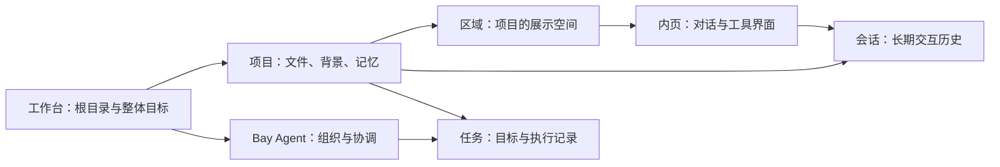

# DSH Bay｜项目定位、目标与发展计划

更新日期：2026-11-13（Asia/Shanghai）。当前私有候选：`0.2.2-alpha.18.7`；目标 DSH：`0.2.2-rc.2`。自动化结果及待完成人工验收见[验证记录](VALIDATION.md)。

本文面向使用者、潜在协作者与开发者，集中说明湾域为什么存在、已经实现什么，以及接下来如何发展。需要立即上手时，阅读[使用教程](USER-GUIDE.zh-CN.md)；需要技术细节时，阅读[当前架构](ARCHITECTURE.zh-CN.md)。

快速阅读：[项目定位](#1-项目定位) · [项目目标](#3-项目目标与成功标准) · [当前功能](#5-目前已经实现的功能) · [长期计划](#6-长期开发计划) · [使用概览](#7-使用方法概览)。

## 1. 项目定位

**DSH Bay（湾域）是基于 DSH 的项目型 AI 工作台：将项目文件、对话、工具界面、任务和记忆组织在一个可以持续工作、交接和迁移的空间中。**

用户在一个工作台里组织多个项目，通过区域安排界面，在每个项目中保留多条独立对话，并让 Bay Agent 协调任务。工作结束后，项目资料仍然有清晰的归属；换一台机器时，可以通过完整工作台包恢复工作内容和历史，再主动继续。

插件开发是当前的重要场景：用户可以在原生创造模式中开发或适配容器内页扩展，放到工作台中验证，并通过可迁移扩展制品参与离线分发。项目模型也适用于代码开发、资料研究、文档整理等长期工作，但不同场景的成熟度需要分别验证。

湾域以 DSH 插件形式运行，使用 DSH 的模型连接、Agent Loop、原生会话、工具和插件管理能力。DSH 提供执行基础，Bay 提供项目组织、工作界面、任务协调和迁移关系。

### 面向的人

| 使用者 | 典型需要 | 湾域提供的组织方式 |
| --- | --- | --- |
| DSH 插件开发者 | 同时处理代码、对话、终端、预览与插件状态 | 项目区域、多内页、创造模式开发技能和修复会话 |
| 持续使用 AI 完成项目的人 | 多轮讨论后仍保留目标、文件、决策与进展 | 项目背景、记忆、历史会话和任务关联 |
| 同时处理多个任务的人 | 区分任务上下文，观察执行与待处理事项 | 多项目、多会话、Bay Agent 与任务视图 |
| 需要交接工作的人 | 把文件之外的对话和任务关系交给接收方 | V5 完整工作台包及恢复报告 |
| 在本机浏览器或局域网协作的人 | 沿用主机运行环境，共同查看与参与工作 | 浏览器主控交接和具有明确范围的在线分享 |

当前交付仍是私有实验版，重点是验证这些工作方式。它没有公开稳定版或全部跨平台验收完成的记录。

## 2. 要解决的问题

### 工作被分散到许多临时界面

聊天记录、工作目录、终端、文件预览和任务结果常常分散保存。用户回到项目时，需要重新判断哪条对话对应哪个目录、哪次执行产生了哪个结果。

湾域以工作台和 Project 建立持久关系，再用区域和内页呈现。界面可以重新组织，项目事实继续保留。

### 长期上下文容易依赖单条聊天

一条很长的会话并不适合承载所有项目事实。历史压缩、切换模式或重新分工时，目标与已确认决策可能难以查找。

湾域把背景、记忆、原始对话和任务账本分开管理。背景说明目标与约束；记忆保存带来源的事实与决策；对话保留交互经过；账本记录任务执行过程。

### 多 Agent 执行缺少任务连续性

只创建更多会话，不能自动解决“这个任务是否已经开始、由谁执行、为什么暂停、应该继续哪个会话”等问题。

Bay Agent 使用持续任务与执行尝试两个层次组织工作，发现可用 Worker 模式，关注报告与待处理事项，继续任务时优先找到原会话。

### 分享文件无法完整交接工作

业务文件只是工作的一部分。原生历史、附件、项目资料、任务引用和扩展状态也影响接收方能否继续。

完整工作台包负责收集并恢复这些内容。导入报告分别呈现数据、环境和任务状态，接收方确认环境后主动继续。在线局域网分享则访问主机上的同一工作台，不承担离线迁移职责。

## 3. 项目目标与成功标准

| 目标 | 用户应当得到的结果 | 如何判断 |
| --- | --- | --- |
| 工作有归属 | 文件、背景、记忆、会话和任务可以按项目找到 | 关闭区域后，原项目资料仍可从新区域访问 |
| 界面可自由整理 | 切换、移动、浮动或关闭内页不改写原会话身份 | 同区域多会话不串线；共享会话视图保持同一历史 |
| 任务可持续 | 新任务与继续旧任务有明确区别 | 续做使用任务身份，执行重试不重复制造任务 |
| 上下文可理解 | 用户能区分目标、事实、推断、历史和进度 | 背景可编辑，记忆可查来源/修订，压缩边界可说明 |
| 迁移可核验 | 接收方知道哪些内容已恢复、哪些环境尚未准备 | 文件/资源/关系校验通过，实际续聊和恢复任务成功 |
| 跨端可恢复 | 桌面、浏览器与原版模式往返后仍可工作 | 主控唯一，关页后可收回，真实输入与发送正常 |
| 扩展可维护 | 新扩展知道自己绑定什么、如何保存、如何迁移 | 通过声明、模板、安装、内页与完整包的分层验证 |

这些是产品成功标准，不是对当前所有环境已经通过的声明。证据与未验证项统一记录在 [VALIDATION.md](VALIDATION.md)。

## 4. 产品模型

| 概念 | 使用者需要知道的含义 |
| --- | --- |
| 工作台 | 一组相关工作的容器，拥有自己的根目录和整体背景 |
| 项目 | 根目录中的一个子文件夹及其长期资料 |
| 区域 | 展示项目的空间，可以创建、移动或关闭 |
| 内页 | 区域或浮动工作区中的一个标签，显示具体对话、工具或资源 |
| 会话 | DSH 原生对话；关闭标签不会删除它 |
| 任务 | 持续存在的一项目标；每次执行尝试另有身份与结果 |
| 记忆 | 已记录的项目知识，带来源、验证状态与修订 |

同一项目可由多个区域展示，共用背景、记忆和历史入口。区域各自保留布局和打开的内页。多个区域使用同一目录并不提供并发文件修改隔离。

工作台、区域、会话和任务都不应仅由显示名称识别。用户可以改名字，底层关系仍由稳定身份维护。

## 5. 目前已经实现的功能

这里的“已实现”表示当前源码与对应自动化/受控验证已有支持；实机验证范围仍以统一记录为准。

| 功能 | 当前行为 | 需要知道的边界 |
| --- | --- | --- |
| 工作台创建 | 选择父目录、预览最终位置，配置布局和可选背景 | 提交不确定时继续同一次创建；不迁移 17.x 工作台结构 |
| 项目目录 | 根内新建或选择已有目录，登记持久 Project | 普通项目不能绑定根外目录或保留的 `.bay` 管理目录 |
| 区域生命周期 | 关闭移除展示区域，项目资料保留 | 启动中/运行中的关联任务先处理；不自动删除文件 |
| 项目概览 | 背景、记忆、历史对话和任务集中展示 | 重新打开只显示概览，不自动恢复旧标签或执行 |
| 多会话 | 同一区域可新建/选择多个明确 Session | 同目录不等于同会话；切换标签不批量改绑 |
| 浮动工作区 | 辅助内页与 Main 展示，可按项目关系转入区域 | Main 标签显隐不等于关闭会话或停止任务 |
| 总览与侧栏 | 列表/详情、项目/区域概览、固定到 DSH 侧栏 | 真正原生导航和发送仍需安装后验收 |
| 背景编辑 | 工作台与项目背景可编辑，独立单轮 AI 草稿 | 草稿先确认；Markdown 为投影，不承诺外部编辑同步 |
| 专属记忆 | 新增、搜索、修改、移除，查看来源与修订 | 记忆内容需要核验，不以摘要替代原始历史 |
| Bay Main | 持久主会话使用根目录，管理任务与报告 | 用户控制显示与执行；并非无人监管运行保证 |
| Worker 模式 | 从当前 DSH 注册表返回模式及介绍，由 Main 选择 | 对话工具的自动选择与手动任务表单的模式选择不同 |
| 任务执行 | Work Item、Assignment、Attention、停止/恢复/验收 | 停止不会撤销已完成的文件修改；ready 仍需评审 |
| 压缩与恢复 | Main 原生压缩、工具结果裁剪、编排 checkpoint、报告队列 | 三者职责不同，外部 Runtime 的完整能力需单独验证 |
| 浏览器主控 | 接管同一工作台，继承扩展许可，收回显示进度 | 刷新/关闭宽限与失联恢复不同；真实多浏览器待验收 |
| 局域网协作 | 审阅/协作模板及指定范围，访客可参与已有会话 | 任意插件、Runtime 与真实跨设备能力不能一概承诺 |
| 完整包 V5 | 文件、历史、附件、项目资料、任务快照与扩展依赖 | 环境和凭据不随数据恢复就自动可用；任务主动继续 |
| 扩展开发与修复 | 原生 cordis 技能、模板、分类菜单、浮动修复会话 | 实际安装、运行、离线迁移需各自通过验收 |

截至功能基线，完整回归为 162 个测试文件、1048 项通过，已完成 RC1 兼容、类型检查、构建和私有封包。它们证明对应检查通过，不替代真实模型长时间运行或九种平台迁移组合。

### 已知收尾事项

- 项目目录弹窗仍残留“共用目录但各自保留背景”的旧提示；实际项目模型为共享背景和记忆，文案应在稳定化阶段修正。
- 当前安装后完整创建/导入、原版往返发送和跨端恢复需要集中留证，而非只积累零散反馈。
- 编排存储仍有按文件读写、大小上限及跨文件提交边界；性能优化应测量后实施。
- 公开发布、自动化三平台矩阵与长期运行结果尚未完成。

## 6. 长期开发计划

以下是本次整理形成的建议路线，按依赖与风险排序，不预先承诺版本号或日期。近期主线延续既定顺序：**先稳定 18.0，再讨论和实施源码结构优化，再做有测量依据的性能优化。**

| 阶段 | 核心交付 | 完成条件 |
| --- | --- | --- |
| A：18.0 稳定化 | 修正残余文案/生命周期问题，整理真实安装与迁移验收 | 创建、项目重开、任务续用、原版往返、浏览器收回、完整包续聊均有可复查记录 |
| B：源码结构优化 | 按目录/项目、会话/内页、Agent、在线访问、完整包明确模块与依赖 | 形成模块图、公共契约和分步移动方案；行为与包协议保持，原测试通过 |
| C：性能与可靠性 | 测量启动/切换、内页保留、事件投影、存储读写及大包资源使用 | 建立同一数据集的前后基线，定位瓶颈并验证改善；性能收益不损害恢复正确性 |
| D：Agent 持续工作 | 改善任务反馈、记忆核验、恢复可观测性和 Runtime 能力声明 | 完成至少一次 8 小时真实运行、宿主重启及另一机器继续；记录重复任务与资源增长 |
| E：迁移与在线协作 | 完善环境恢复报告、多平台兼容、访问范围和协作体验 | 九种来源/目标平台迁移、真实 LAN 设备及多浏览器核心流程逐项验收 |
| F：扩展生态与交付 | 完善开发技能、契约校验、兼容诊断和可重复制品 | 原生创造模式产出扩展，经安装、升级、完整包迁移后可用；再评估公开发布 |

阶段可以在边界清晰时部分并行，但源码结构重构不应顺带修改包格式、改变 Agent 策略或引入未定义的全局状态。

### 性能工作重点

应优先建立真实工作负载：多个工作台、同项目多区域、大量会话/内页、长编排历史和大小文件混合的归档。记录启动时间、交接时间、内页切换延迟、内存、磁盘读写与峰值资源。

具体指标目标在取得基线后确定。不能只根据代码体积或文件数量判断性能，也不把拆文件本身当成性能提升。

### Agent 工作重点

让用户可以回答“谁在执行、为什么停下、用了哪个模式、依据哪些记忆、还缺什么、继续会做什么”。优先验证任务身份、上下文边界、报告可靠投递和恢复策略，再讨论更复杂的自动规划与外部 Runtime。

未经确认的记忆、重复任务和恢复后重复副作用都需要显式记录。主控、Worker 与原生工具的职责必须保持可追踪。

### 暂不承诺的探索

IM 接入、云端运行/账号同步、公开作品社区、自动 Git worktree 隔离和更多远程 Runtime 可以作为独立议题。它们需要明确需求、成本与生命周期设计，当前不纳入已交付能力，也不阻塞 18.0 稳定化。

## 7. 使用方法概览

一个最小练习是：创建“插件实验室”工作台，为区域新建 `notes-panel` 项目，在项目概览写目标，通过“官方内置 → 新建对话”选择创造模式，尝试开发一个简单内页。关闭区域后，从总览“项目与区域”重新打开该项目，确认资料保留，再导出完整包并导入到另一位置。

详细步骤、可复制的背景/任务示例、浏览器交接、导入失败处理和常见问题见[完整使用教程](USER-GUIDE.zh-CN.md)。教程中的练习是建议验收路径，不表示已替用户实际执行或安装。

## 8. 开发与文档协作

功能讨论先说明使用场景、数据归属和预期行为；实现记录说明修改位置、验证证据和未覆盖环境。版本级变化进入 CHANGELOG，最新验证集中在 VALIDATION，旧方案进入归档并保留替代入口。

定位与目标由本文维护；操作步骤由使用教程维护；技术协议由架构、专题与扩展规范维护。新增能力时同时检查这三层是否一致，避免“产品说明说支持、教程无法操作、接口又是另一套含义”。

DSH Bay 是独立社区项目，与 DeepSeek 没有官方隶属关系。运行时和依赖的许可、来源、构建与发布流程见[仓库主说明](../README.md)和[封包说明](PUBLISHING.zh-CN.md)。
